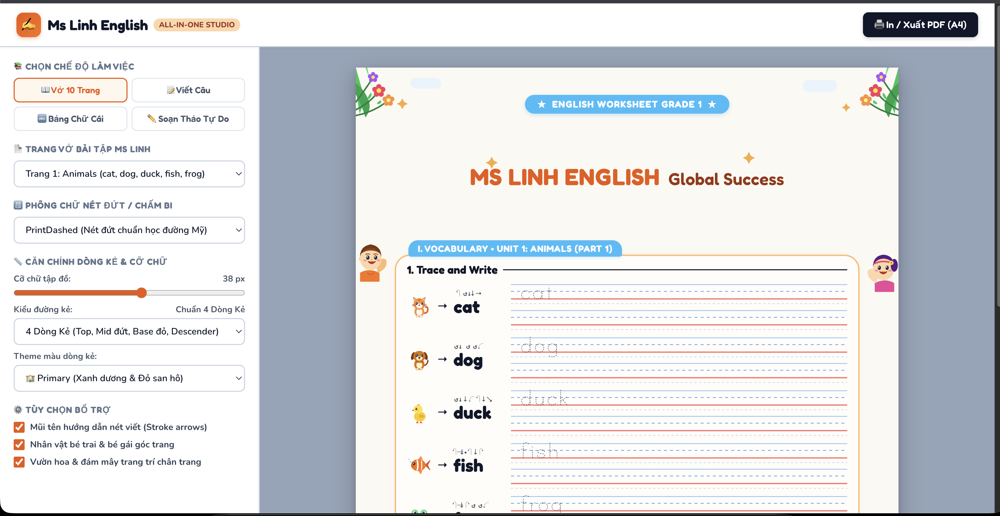

<div align="center">

# ✏️ Ms Linh English 🌈

### Vở tập viết tiếng Anh cho bé · English handwriting workbook for kids

**Global Success · Primary School**

[](https://vkas0812-sys.github.io/tlinh_enlish/)




</div>

---

## 🌟 Giới thiệu · About

🇻🇳 **Ms Linh English** là công cụ tạo **vở tập viết tiếng Anh in ra giấy** cho bé tiểu học, bám theo chương trình **Global Success**. Bé vừa tô chữ, vừa học từ vựng qua hình ảnh dễ thương.

🇬🇧 **Ms Linh English** creates **printable English handwriting worksheets** for primary pupils, following the **Global Success** curriculum. Kids trace letters and learn vocabulary with cute pictures.

---

## 🎨 Tính năng · Features

| | 🇻🇳 Tiếng Việt | 🇬🇧 English |
|---|---|---|
| 📖 | **Vở 10 trang** theo chủ đề: Animals, Numbers 1–20, Colours, Toys & Things, Clothes & Home | **10-page workbook** by topic: Animals, Numbers 1–20, Colours, Toys & Things, Clothes & Home |
| 📝 | **Viết câu** – luyện viết câu hoàn chỉnh | **Sentences** – practise full sentences |
| 🔤 | **Bảng chữ cái** A–Z | **Alphabet** sheets A–Z |
| ✏️ | **Soạn thảo tự do** – tự nhập từ muốn tập | **Free editor** – type any words to practise |
| 🖋️ | 4 phông chữ: nét đứt, chấm bi, nét liền, nét gạch | 4 fonts: dashed, dotted, solid, trace |
| 📏 | Dòng kẻ 4 dòng chuẩn hoặc 2 dòng tối giản, chỉnh cỡ chữ | 4-line or 2-line guides, adjustable size |
| 🌈 | 4 theme màu: Primary, Vở Ô Ly, Slate, Pastel Candy | 4 colour themes: Primary, Ô Ly, Slate, Pastel Candy |
| ➡️ | Mũi tên hướng dẫn nét viết | Stroke-direction arrows |
| 👧🧒 | Nhân vật bé trai, bé gái, vườn hoa trang trí | Boy & girl characters, flower decorations |
| 🖨️ | **In / Xuất PDF khổ A4** | **Print / Export A4 PDF** |

---

## 🚀 Cách dùng · How to use

1. 🌐 **Mở app** · Open the app → [vkas0812-sys.github.io/tlinh_enlish](https://vkas0812-sys.github.io/tlinh_enlish/)
2. 📂 **Chọn chế độ và trang** · Pick a mode and a page
3. 🎛️ **Chỉnh phông, dòng kẻ, màu** · Adjust font, lines and colours
4. 🖨️ **Bấm "In / Xuất PDF (A4)"** · Click "Print / Export PDF (A4)"

> 💡 **Mẹo · Tip:** chọn *"Toàn bộ 10 trang"* để in trọn bộ một lần · choose *"All 10 pages"* to print the whole set at once.

---

## 🛠️ Công nghệ · Built with

Một file `index.html` duy nhất (HTML + CSS + JavaScript), không cần cài đặt, chạy trên mọi trình duyệt.
A single `index.html` file (HTML + CSS + JavaScript) – no install, runs in any browser.

```text
.
├── index.html                 # App (HTML + CSS + JS)
├── favicon.svg                # Biểu tượng · Icon
├── LICENSE                    # CC BY-NC 4.0
├── docs/screenshot.png        # Ảnh minh hoạ · Screenshot
├── .github/workflows/         # Tự đăng lên GitHub Pages · Auto-deploy
└── README.md
```

---

## 📄 Bản quyền · License

🇻🇳 Phát hành theo giấy phép [CC BY-NC 4.0](LICENSE): được dùng và chỉnh sửa, ghi nguồn, không dùng thương mại.
🇬🇧 Released under [CC BY-NC 4.0](LICENSE): free to use and adapt with credit, no commercial use.

<div align="center">

Made with 💛 by [@vkas0812-sys](https://github.com/vkas0812-sys) · ⭐ *Học vui mỗi ngày · Happy learning every day!* ⭐

</div>
